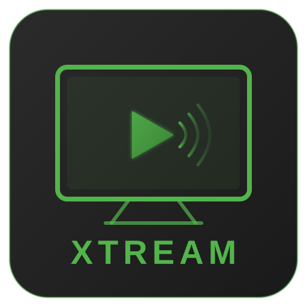

<p align="center">
  
</p>

<h1 align="center">Xtream Tuner</h1>

<p align="center">
  An Emby Server plugin that turns an Xtream-compatible IPTV service into Live TV with a guide, plus Movies and Series libraries.
</p>

<p align="center">
  <a href="../../releases/latest"></a>
  
  
</p>

---

## What it does

- **Live TV**: your provider's channels in Emby's TV guide, with recordings.
- **Movies and Series**: the provider's catalogue as `.strm` files, so Emby builds normal Movie and TV Show libraries with its own metadata and artwork.
- **Dispatcharr** (optional): play through [Dispatcharr](https://github.com/Dispatcharr/Dispatcharr) to manage streams and connections.
- **Dashboard**: sync status, history and library counts inside the plugin settings.

## Requirements

- Emby Server **4.9 or 4.10**. One DLL works on both.
- An Xtream Codes compatible IPTV account (server URL, username, password).
- Optional: Emby Premiere, if you want Emby's own guide data instead of the provider's.

---

## Installation

### 1. Install the plugin

Download `Emby.Xtream.Plugin.dll` from the [latest release](../../releases/latest), copy it to Emby's `plugins` folder and restart Emby.

```bash
# Docker
docker cp Emby.Xtream.Plugin.dll emby:/config/plugins/
docker restart emby

# Linux
cp Emby.Xtream.Plugin.dll /var/lib/emby/plugins/
systemctl restart emby-server
```

On macOS and Windows, copy the DLL to `plugins/` in your Emby data folder and restart Emby Server.

> Releases also contain `Emby.Xtream.Plugin-4.10.dll`. It is the same file under the name older 4.10 installs look for, so either one works.

### 2. Connect to your provider

1. Open **Settings → Plugins → Xtream Tuner**.
2. On the **Connection** tab, enter the server URL (for example `http://your-provider:port`), username and password.
3. Click **Test Connection**, then **Save**.
4. On the **Library** tab, check the **Library Folder** (default `/config/xtream`) and turn on **Auto-Sync** if you want syncs on a schedule.

### 3. Live TV

1. On the **Live TV** tab, click **Refresh Categories** and pick the channel groups you want.
2. Choose a **Guide Source**: the Xtream server (default), a custom XMLTV URL, or none. With Emby Premiere you can tick **Use Emby Guide Data (Emby Premiere only)** instead.
3. Click **Save**.
4. In **Emby Settings → Live TV**, add a tuner of type **Xtream Tuner**. Its channels come straight from the plugin.

### 4. Movies and Series (optional)

1. On the **Movies** tab, tick **Enable Movies** and click **Refresh Categories**.
2. Pick a folder layout:
   - **Single Folder**: every movie in `Movies/`. You can also untick individual titles.
   - **Multiple Folders**: make your own folders and assign categories to each.
3. Click **Sync Movies Now**.
4. In Emby, add a **Movies** library on `/config/xtream/Movies`.

Series work the same way on the **Series** tab. The library path is `/config/xtream/Shows`.

### 5. Dispatcharr (optional)

1. On the **Connection** tab, tick **Enable Dispatcharr** and enter its URL, username and password.
2. Click **Test Dispatcharr Connection**, then **Save**.
3. Playback options for Dispatcharr channels are on the **Live TV** tab under **Dispatcharr Playback**.

### Updating

When a new version is out, the plugin settings show an update banner. Click **Update Now**, then **Restart Emby**. Your settings are kept. To get test versions early, turn on **Beta Channel** under **Connection → Updates**.

---

## Features

### Live TV

- Channel groups to include, with an opt-in for adult channels.
- MPEG-TS or HLS streams from the Xtream server. Channels through Dispatcharr always play as MPEG-TS, whatever output format Dispatcharr is set to.
- Guide from the Xtream server, a custom XMLTV URL, or Emby's guide data (Premiere), 1 to 14 days ahead.
- Recordings keep retrying until the stream is live, and reconnect if it drops mid-recording. An event recording that starts before the broadcast does not end up empty.
- Optional DVB subtitles, and an option that converts AC3/EAC3 audio to AAC for iPhone and iPad (which otherwise play those channels without sound).

### Movies and Series

- `.strm` files Emby treats as normal libraries. Series follow `Show/Season 01/Show - S01E01 - Title.strm`.
- Optional metadata IDs in folder names (`[tmdbid=…]`, `[tvdbid=…]`), so Emby matches titles right away. Missing IDs can be looked up through Emby's metadata providers. TVDb IDs can be set by hand for shows that do not match.
- Optional `.nfo` files.
- Name clean-up removes provider tags such as `|UK|`, plus your own terms.
- Untick single movies or series to stop syncing them. Their files are removed on the next sync.

### Sync

- Only new or changed titles are written, so later syncs are quick.
- Titles the provider no longer has are removed (on by default). Once there are more than 10 files, a **Removal Safety Limit** (default 20%) stops a sync from deleting more than that share at once, for example when the provider returns half a catalogue. If a category fails to load, or the provider returns nothing at all, nothing is removed.
- Only files the plugin wrote itself are deleted. Your own files in the same folder stay.
- Runs on a schedule (every N hours or daily at a set time) or by hand.
- **Retry Failed Items** on the Dashboard retries the titles that failed in the last sync.

### Dispatcharr

- Live TV plays through Dispatcharr's proxy. If Dispatcharr does not know a channel, it can fall back to the Xtream server.
- **Stream URL → Xtream server** plays channels through Dispatcharr's Xtream URL instead, so Dispatcharr shows which user is watching.
- Codec, resolution and bitrate come from Dispatcharr's stream stats (for example filled by [Streamflow](https://github.com/krinkuto11/streamflow)), so channels start without a probe. The video codec follows the channel's stream profile, and can be overridden.
- Movies that Dispatcharr has from more than one provider get one version per provider.

### Dashboard and settings

- Last sync, history of the last 10 syncs, library counts and live progress.
- **Download Sanitized Log**: the plugin log with passwords, tokens, IP addresses, email addresses and the provider's hostname removed, ready to attach to a bug report.
- Only Emby administrators can open or change the plugin settings.

---

## Troubleshooting

**"Cannot connect to Xtream server", while the same account works in a player app**
Some providers refuse requests without a familiar User-Agent. Set one under **Connection → Advanced → User-Agent**, for example `VLC/3.0.21 LibVLC/3.0.21`, and click **Test Connection** again.

**Timeshift (pause, rewind) does not work on Apple TV, iOS or Android**
Those apps play the stream directly, which skips the buffer Emby needs for timeshift. Turn on **Playback correction** in the app's settings. This is an Emby limitation that applies to every tuner type.

**The guide grid is empty even though channels are there**
The browser has an old guide filter stored. Click the filter icon in the guide and clear it, or run `localStorage.removeItem('guide-tagids')` in the browser console.

**After upgrading Emby to 4.10 the plugin does not load (`Method 'AddConsumer' ... does not have an implementation`)**
Plugin v1.4.97 and older do not load on 4.10, so the update banner is not shown. Download `Emby.Xtream.Plugin.dll` from the [latest release](../../releases/latest) by hand once. Updates work normally after that.

**Reporting a bug**
Open an [issue](../../issues/new/choose), say which plugin and Emby versions you run, and attach the log from **Dashboard → Download Sanitized Log**.

---

## Security note: credentials in `.strm` files

The Xtream protocol puts your username and password in every stream URL; there is no token form. So your credentials are stored in plain text in the `.strm` files under the Library Folder, and in the M3U playlist the plugin serves. Anything that can read those files (other containers on the same volume, backup tools, users with shell access) can read the credentials.

To limit this:

- **Use Dispatcharr.** Live TV and movies that Dispatcharr has from more than one provider then use Dispatcharr's proxy URLs, which contain no credentials. Other movies and series episodes still use the Xtream URL, and so does Live TV when **Stream URL** is set to the Xtream server.
- **Restrict access** to the Library Folder, and do not mount it into unrelated containers.
- **Use a separate provider account** for Emby, if your provider allows it, so you can change it on its own.

---

## Building from source

Requires the .NET 10 SDK (the plugin targets .NET Standard 2.0; the build also runs the tests).

```bash
git clone https://github.com/firestaerter3/emby-xtream.git
cd emby-xtream/Emby.Xtream.Plugin
bash build.sh
```

The DLL ends up in `Emby.Xtream.Plugin/out/`. Design decisions are in [`docs/decisions`](docs/decisions).

## License

MIT
